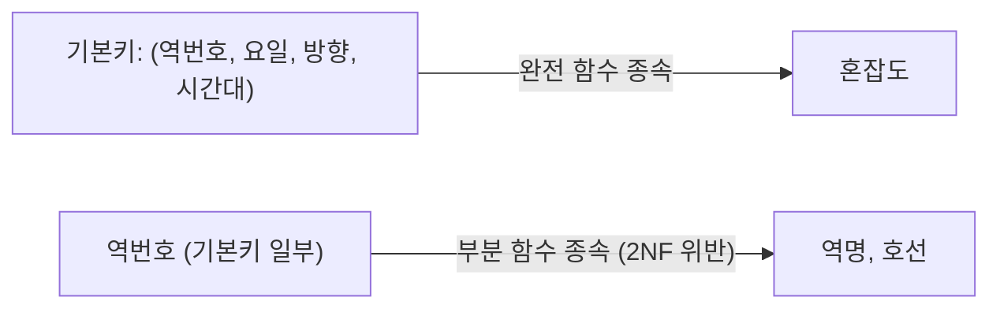

# 함수 종속성 및 이상현상 분석서 (04_함수종속성_이상현상_분석서.md)

## 1. 개요

데이터베이스 설계에서 비정규화된 중복 데이터는 삽입·삭제·수정 시 이상현상(Anomaly)을 유발한다. 본 문서는 수집된 공공데이터의 함수 종속성(Functional Dependency)을 분석하고, 이상현상 발생 원인과 이를 해결하기 위한 무손실 분해(Lossless Decomposition) 및 정규화 과정을 기술한다.

---

## 2. 원본 데이터의 함수 종속성 및 이상현상 분석

### 2.1 원본 혼잡도 데이터 (Raw Congestion)
- **속성 구성**: `(역번호, 역명, 호선, 요일, 방향, 시간대, 혼잡도)`
- **기본키(PK 후보)**: `(역번호, 요일, 방향, 시간대)`

#### 발생 원인: 부분 함수 종속 (Partial Functional Dependency)
- 결정자인 기본키 전체가 아니라 기본키의 일부인 `역번호`가 `역명`과 `호선`을 독립적으로 결정함:
  $$\text{역번호} \rightarrow \{\text{역명}, \text{호선}\}$$
- 복합키의 일부에 종속되므로 제2정규형(2NF)을 위반함.

#### 발생하는 3대 이상현상 사례
1. **수정 이상 (Modification Anomaly)**
   - 특정 역명이 변경될 경우 동일 역번호를 가진 다수의 혼잡도 레코드를 모두 수정해야 하며, 일부 튜플만 수정될 경우 데이터 불일치가 발생함.
2. **삽입 이상 (Insertion Anomaly)**
   - 신규 역이 추가되었으나 해당 역의 혼잡도 측정 데이터가 존재하지 않는 경우, 기본키 구성 요소인 `(요일, 방향, 시간대)`가 `NULL`이 될 수 없어 신규 역 정보를 등록할 수 없음.
3. **삭제 이상 (Deletion Anomaly)**
   - 특정 기간이나 조건의 혼잡도 레코드를 삭제할 때, 해당 역의 고유 정보(역명, 소속 노선)까지 함께 삭제됨.

---

## 2.2 원본 승하차 데이터 (Raw Ridership)
- **속성 구성**: `(수송일자, 호선, 역번호, 역명, 시간대, 승차인원, 하차인원)`
- **기본키(PK)**: `(수송일자, 역번호, 시간대)`

#### 발생 원인 및 이상현상
- 기본키의 일부인 `역번호`가 `호선`과 `역명`을 결정함:
  $$\text{역번호} \rightarrow \{\text{호선}, \text{역명}\}$$
- 날짜와 시간대마다 동일한 호선명과 역명이 반복 저장되어 데이터 중복이 발생함.
- 신규 역 등록 시 승하차 실적이 없으면 저장이 불가하고(삽입 이상), 승하차 이력 삭제 시 역 기본 정보가 함께 삭제되는 현상(삭제 이상)이 발생함.

---

## 2.3 원본 빠른하차 데이터 (Raw Fast Exit)
- **속성 구성**: `(관리번호, 역코드, 역명, 호선, 이동설비명, 칸문번호, 위치설명 ...)`
- **함수 종속성**:
  - $\text{관리번호} \rightarrow \{\text{역코드}, \text{이동설비명}, \text{칸문번호}, \dots\}$
  - $\text{역코드} \rightarrow \{\text{역명}, \text{호선}\}$
- 관리번호가 기본키일 때, $\text{관리번호} \rightarrow \text{역코드} \rightarrow \{\text{역명}, \text{호선}\}$의 **이행적 함수 종속(Transitive Functional Dependency)**이 존재하여 제3정규형(3NF)을 위반함.

---

## 3. 릴레이션 무손실 분해 및 BCNF 검토

### 3.1 릴레이션 분해 과정
함수 종속성을 기준으로 이상현상을 유발하는 속성을 분리하여 릴레이션을 분해함:

1. **역 마스터 분해**:
   - `STATION`: $(\underline{\text{station\_id}}, \text{station\_name})$
   - `LINE`: $(\underline{\text{line\_code}}, \text{line\_name})$
   - `LINE_STATION`: $(\underline{\text{station\_cd}}, \text{station\_id}^*, \text{line\_code}^*, \text{source\_station\_name}, \text{external\_code})$
2. **트랜잭션 측정 데이터 분해**:
   - `CONGESTION`: $(\underline{\text{congestion\_id}}, \text{station\_cd}^*, \text{day\_type}, \text{direction}, \text{time\_start}, \text{congestion\_rate})$
   - `RIDERSHIP`: $(\underline{\text{station\_cd}}^*, \underline{\text{transport\_date}}, \underline{\text{time\_slot}}, \text{boarding\_count}, \text{alighting\_count})$
3. **편의시설 데이터 분해**:
   - `FACILITY_TYPE`: $(\underline{\text{facility\_type\_id}}, \text{facility\_type\_name})$
   - `FAST_EXIT`: $(\underline{\text{management\_no}}, \text{station\_cd}^*, \text{facility\_type\_id}^*, \dots)$

### 3.2 무손실 조인 분해(Lossless Join Decomposition) 증명
- 릴레이션 $R$을 $R_1(\text{LINE\_STATION})$과 $R_2(\text{CONGESTION})$으로 분해할 때:
  - 공통 속성: $R_1 \cap R_2 = \{\text{station\_cd}\}$
  - 함수 종속성: $\text{station\_cd} \rightarrow R_1$ 성립 ($\text{station\_cd}$는 $R_1$의 기본키)
- 공통 속성이 분해된 릴레이션 중 하나의 슈퍼키(Superkey)에 해당하므로, **자연 조인(Natural Join)을 통해 원본 데이터를 손실 없이 복원 가능한 무손실 분해** 조건을 만족함.

### 3.3 BCNF (Boyce-Codd Normal Form) 만족 검토
- 분해된 7개 릴레이션의 모든 함수 종속 $X \rightarrow Y$에서 결정자 $X$는 각 릴레이션의 슈퍼키임.
- 비주요 속성이 다른 비주요 속성을 결정하는 이행적 종속이 제거되었으며, 모든 결정자가 후보키 이상이므로 **설계된 릴레이션은 BCNF를 만족함**.
