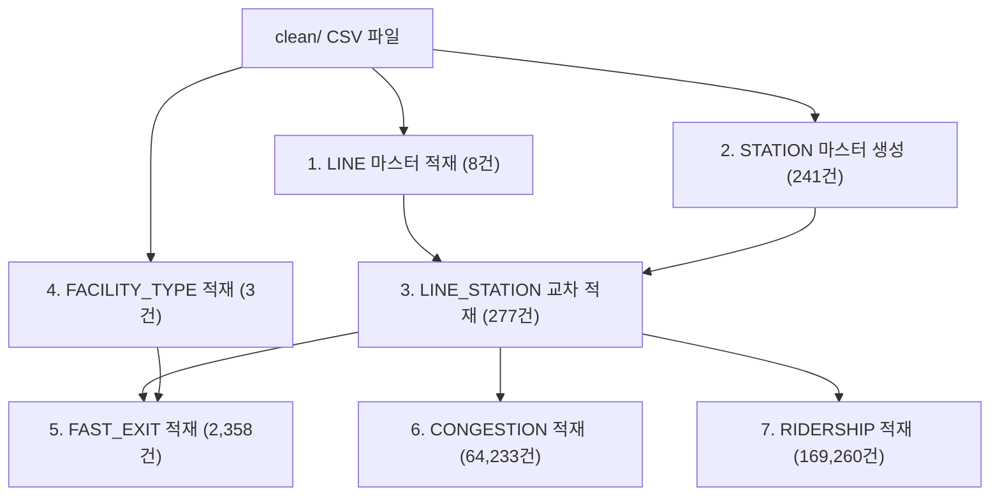

# 데이터베이스 구축 및 SQL 명세서 (05_DB구축_및_SQL_명세서.md)

## 1. 구현 환경

- **DBMS**: MySQL Server 8.0.46 (InnoDB 스토리지 엔진)
- **문자 집합 (Charset)**: `utf8mb4` / 콜레이션: `utf8mb4_unicode_ci`
- **적재 언어 및 라이브러리**: Python 3, PyMySQL
- **백업 도구**: `mysqldump` (MySQL 8.0)

---

## 2. 테이블 생성 및 제약조건 명세 (DDL)

전체 테이블 DDL 스크립트는 [`schema.sql`](file:///c:/Users/jihun/Desktop/jihun/hansung/2학년/데이터베이스/기말/schema.sql)에 정의되어 있으며, 주요 제약조건은 다음과 같다:

1. **기본키(PK)**:
   - `LINE(line_code)`
   - `STATION(station_id)` (AUTO_INCREMENT)
   - `LINE_STATION(station_cd)` (CHAR(4))
   - `FACILITY_TYPE(facility_type_id)` (AUTO_INCREMENT)
   - `FAST_EXIT(management_no)`
   - `CONGESTION(congestion_id)` (AUTO_INCREMENT)
   - `RIDERSHIP(station_cd, transport_date, time_slot)` (복합 기본키)
2. **외래키(FK) 및 참조 동작**:
   - `ON DELETE CASCADE ON UPDATE CASCADE`를 적용하여 상위 레코드 변경 및 삭제 시 참조 무결성을 유지함.
3. **고유 제약조건(UNIQUE)**:
   - `LINE_STATION(station_id, line_code)`: 동일 노선 내 동일 역 중복 등록 방지.
   - `CONGESTION(station_cd, day_type, direction, time_start)`: 동일 역·요일·방향·시간대의 혼잡도 중복 등록 방지.
4. **인덱스(Index)**:
   - `STATION(station_name)`: 역명 조건 검색 성능 확보.
   - `FAST_EXIT(station_cd, facility_type_id, direction)`: 역코드 및 설비 유형 복합 조건 조회 최적화.
   - `RIDERSHIP(transport_date, time_slot)`: 기간 범위 및 시간대 필터링 시 B-Tree 인덱스 탐색 활용.

---

## 3. 데이터 적재 파이프라인 및 적재 결과

데이터 적재는 [`load_data.py`](file:///c:/Users/jihun/Desktop/jihun/hansung/2학년/데이터베이스/기말/load_data.py)를 통해 외래키 의존 관계 순서에 따라 수행되었다.



### 최종 적재 건수 집계
| 테이블명 | 적재 건수 | 비고 |
| :--- | :---: | :--- |
| `LINE` | 8건 | 1~8호선 마스터 |
| `STATION` | 241건 | 중복 역명 그룹화 및 `station_id` 자동 채번 |
| `LINE_STATION` | 277건 | 노선별 역 매핑 (환승역 1:N 해소) |
| `FACILITY_TYPE` | 3건 | 계단(1), 엘리베이터(2), 에스컬레이터(3) |
| `FAST_EXIT` | 2,358건 | 빠른하차 및 승강기 위치 정보 |
| `CONGESTION` | 64,233건 | 결측치 제외 및 지선 중복 평균 통합본 |
| `RIDERSHIP` | 169,260건 | 2025년 12월 시간대별 승하차 실적 |
| **총계** | **236,140건** | **외래키 참조 무결성 검증 완료** |

---

## 4. 6대 핵심 조회 SQL 명세

전체 쿼리는 [`queries.sql`](file:///c:/Users/jihun/Desktop/jihun/hansung/2학년/데이터베이스/기말/queries.sql)에 수록되어 있으며, 기능별 세부 쿼리는 다음과 같다:

### 4.1 빠른하차 위치 안내 (다중 테이블 조인)
- 5개 테이블(`FAST_EXIT`, `LINE_STATION`, `STATION`, `LINE`, `FACILITY_TYPE`)을 조인하여 하차 위치와 설비 정보를 조회한다.

```sql
SELECT 
    s.station_name AS '역명',
    l.line_name AS '호선',
    ft.facility_type_name AS '이동설비',
    fe.direction AS '운행방향',
    fe.destination_info AS '방면',
    fe.car_door_no AS '하차 칸-문',
    fe.location_name AS '시설 위치명',
    fe.facility_location AS '상세 위치 설명'
FROM FAST_EXIT fe
JOIN LINE_STATION ls ON fe.station_cd = ls.station_cd
JOIN STATION s ON ls.station_id = s.station_id
JOIN LINE l ON ls.line_code = l.line_code
JOIN FACILITY_TYPE ft ON fe.facility_type_id = ft.facility_type_id
WHERE s.station_name = '서울역'
  AND l.line_name = '1호선'
  AND ft.facility_type_name = '엘리베이터'
ORDER BY fe.direction, fe.car_door_no;
```

### 4.2 시간대별 혼잡도 조회 및 정렬
- 특정 역, 호선, 요일, 방향에 대한 30분 단위 혼잡도를 시간순으로 조회한다.

```sql
SELECT 
    s.station_name AS '역명',
    l.line_name AS '호선',
    c.day_type AS '요일',
    c.direction AS '방향',
    c.time_start AS '시간대',
    c.congestion_rate AS '혼잡도'
FROM CONGESTION c
JOIN LINE_STATION ls ON c.station_cd = ls.station_cd
JOIN STATION s ON ls.station_id = s.station_id
JOIN LINE l ON ls.line_code = l.line_code
WHERE s.station_name = '한성대입구'
  AND l.line_name = '4호선'
  AND c.day_type = '평일'
  AND c.direction = '상선'
ORDER BY c.time_start ASC;
```

### 4.3 노선 및 기간별 역 승하차 집계 및 정렬 (GROUP BY, SUM)
- 지정 기간 동안 노선 내 역별 승하차 인원을 합산하고 내림차순 정렬하여 상위 역을 도출한다.

```sql
SELECT 
    s.station_name AS '역명',
    l.line_name AS '호선',
    SUM(r.boarding_count) AS '총 승차인원',
    SUM(r.alighting_count) AS '총 하차인원',
    SUM(r.boarding_count + r.alighting_count) AS '총 이용객 합계'
FROM RIDERSHIP r
JOIN LINE_STATION ls ON r.station_cd = ls.station_cd
JOIN STATION s ON ls.station_id = s.station_id
JOIN LINE l ON ls.line_code = l.line_code
WHERE l.line_name = '2호선'
  AND r.transport_date BETWEEN '2025-12-01' AND '2025-12-07'
GROUP BY s.station_id, s.station_name, l.line_name
ORDER BY SUM(r.boarding_count + r.alighting_count) DESC
LIMIT 10;
```

### 4.4 환승역 정보 조회 (M:N 교차 릴레이션 검증)
- 특정 역을 경유하는 노선 목록과 노선별 전철역 코드를 조회한다.

```sql
SELECT 
    s.station_name AS '역명',
    l.line_name AS '경유 호선',
    ls.station_cd AS '전철역코드'
FROM STATION s
JOIN LINE_STATION ls ON s.station_id = ls.station_id
JOIN LINE l ON ls.line_code = l.line_code
WHERE s.station_name = '서울역'
ORDER BY l.line_name;
```

### 4.5 노선별 엘리베이터 설치 현황 (JOIN, COUNT)
- 특정 노선에서 엘리베이터가 설치된 역과 설치 칸 수를 집계한다.

```sql
SELECT 
    s.station_name AS '역명',
    l.line_name AS '호선',
    COUNT(fe.management_no) AS '엘리베이터 설치 칸 수'
FROM LINE_STATION ls
JOIN STATION s ON ls.station_id = s.station_id
JOIN LINE l ON ls.line_code = l.line_code
JOIN FAST_EXIT fe ON ls.station_cd = fe.station_cd
JOIN FACILITY_TYPE ft ON fe.facility_type_id = ft.facility_type_id
WHERE l.line_name = '4호선'
  AND ft.facility_type_name = '엘리베이터'
GROUP BY s.station_id, s.station_name, l.line_name
ORDER BY COUNT(fe.management_no) DESC;
```

### 4.6 특정 시간대 노선 내 혼잡 역 순위 (ORDER BY DESC, LIMIT)
- 특정 시간대에 노선 내 역들의 혼잡도를 내림차순 정렬하여 상위 10개 역을 도출한다.

```sql
SELECT 
    s.station_name AS '역명',
    l.line_name AS '호선',
    c.direction AS '운행방향',
    c.time_start AS '시간대',
    c.congestion_rate AS '혼잡도'
FROM CONGESTION c
JOIN LINE_STATION ls ON c.station_cd = ls.station_cd
JOIN STATION s ON ls.station_id = s.station_id
JOIN LINE l ON ls.line_code = l.line_code
WHERE l.line_name = '2호선'
  AND c.day_type = '평일'
  AND c.time_start = '08:30:00'
ORDER BY c.congestion_rate DESC
LIMIT 10;
```
    c.congestion_rate AS '혼잡도(%)'
FROM CONGESTION c
JOIN LINE_STATION ls ON c.station_cd = ls.station_cd
JOIN STATION s ON ls.station_id = s.station_id
JOIN LINE l ON ls.line_code = l.line_code
WHERE l.line_name = %s
  AND c.day_type = %s
  AND c.time_start = %s
ORDER BY c.congestion_rate DESC
LIMIT 10;
```

---

## 5. 데이터베이스 구축 및 적재 검증

- 테이블 생성: [`schema.sql`](file:///c:/Users/jihun/Desktop/jihun/hansung/2학년/데이터베이스/기말/schema.sql) 실행
- 데이터 적재: [`load_data.py`](file:///c:/Users/jihun/Desktop/jihun/hansung/2학년/데이터베이스/기말/load_data.py) 실행
- 적재 검증: 7개 테이블의 스키마, 기본키/외래키 제약조건 및 236,140건 데이터 정상 적재 확인 완료.
